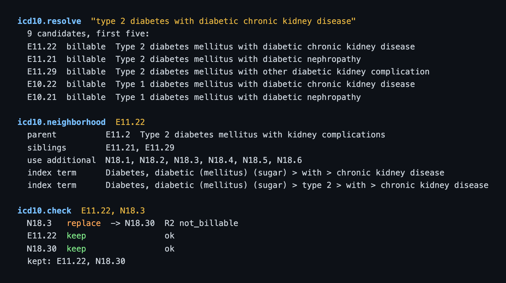

# medgraph

Read the ICD-10-CM code book closely and it is already a graph, written as notes: every code sits under a parent, and the Excludes1, Code first and Use additional notes point at other codes. We turned those notes into typed edges, and medgraph loads the FY2026 book that way on your own machine, where an agent can ask it the three questions below. Free text resolves through the Index terms and the code descriptions, which means the demo never calls a language model.

```bash
bash scripts/demo.sh
```

One run on a shared 16-core Linux machine with nothing cached took 11 minutes: about two to build, and most of the rest to load the code book and its mappings.



The script builds the binary, downloads about 35 MB of public files from CMS and AHRQ, loads the graph into a local SQLite file and prints three answers. Neither the build nor the three answers need an API key or a khive.ai account.

## Requirements

Rust 1.93 or newer, a C toolchain, git, curl and unzip; with jq installed the answers print indented. The directory you clone into must not be group- or world-writable (chmod g-w <parent>, or clone under a 755 directory).

## The three answers

| Question | Verb | What comes back |
|---|---|---|
| "type 2 diabetes with diabetic chronic kidney disease" | `icd10.resolve` | Candidate codes found through the Alphabetic Index terms and the code descriptions, each with its billable flag. |
| What surrounds E11.22? | `icd10.neighborhood` | Everything the book says around the code: its parent, children and siblings (with the axis they differ on), its Excludes notes, the codes its notes tell you to add or code first, and the Index terms that lead to it. |
| Do E11.22 and N18.3 go together? | `icd10.check` | Keep, replace or drop for each code, by seven rules: an unknown code, a non-billable code (replaced when it has exactly one unspecified billable child), a code its own ancestor already covers, an Excludes1 conflict, sex, age, and a missing 7th character. |

To ask your own, call the same binary once the demo has loaded the graph:

```bash
KHIVE_NO_DAEMON=1 KHIVE_PACKS=kg,icd10 target/release/icd10-khive exec \
  --config data/store/medgraph.toml --strict 'icd10.check(codes=["E11.22", "N18.3"])'
```

`KHIVE_NO_DAEMON=1` keeps every call in one process, so a khive server already running on your machine is never contacted.

## What is in the graph

Chapters, blocks, categories, codes and Index terms from the CMS FY2026 Tabular List and Alphabetic Index, with the relations their notes describe. Onto the codes go the AHRQ CCSR clinical categories and the CMS-HCC risk adjustment mappings. Seven coding-guideline rules sit beside them, structured from the CDC ICD-10-CM Official Guidelines for FY2026, and each rule carries its section number and a verbatim quote of the guideline it came from.

## Data

Apart from code, small test fixtures and one 3.4 KB rules file, everything comes from the publisher through `scripts/fetch_data.sh`. Each download's sha256 is checked against the one we recorded, and a note prints when a publisher has replaced the file.

| Input | Published by | Terms | Source |
|---|---|---|---|
| ICD-10-CM FY2026 Tabular List and Alphabetic Index | CMS | US federal publication; the download carries no licence file | https://www.cms.gov/files/zip/2026-code-tables-tabular-and-index.zip |
| CCSR for ICD-10-CM diagnoses, v2026.1 | AHRQ, HCUP | US federal publication; the download carries no licence file | https://hcup-us.ahrq.gov/toolssoftware/ccsr/DXCCSR-v2026-1.zip |
| CMS-HCC 2026 midyear final ICD-10 mappings | CMS | US federal publication; the download carries no licence file | https://www.cms.gov/files/zip/2026-midyear-final-icd-10-mappings.zip |
| Seven guideline rules, `data/rules/guideline-rules-FY2026.jsonl` | structured by us from the CDC ICD-10-CM Official Guidelines FY2026 | Apache-2.0, like the rest of the repository; the quoted guideline text is the CDC's | in the repository |

## Not medical advice

medgraph is built from the public code book and its mappings, and it holds no patient records. A qualified coder or clinician decides every code it suggests, and nothing it prints is medical advice.

## License

Apache-2.0 covers the code and the rules file. The files `fetch_data.sh` downloads come from CMS and AHRQ under their own terms.

## Built on khive

Under medgraph is khive (github.com/ohdearquant/khive), an open-source typed knowledge graph on SQLite. This repository adds one pack to it, `icd10`, with the code-book entity types and verbs; `icd10-khive` is khive's own command-line tool with that pack linked in. In `Cargo.toml` the khive dependency is pinned to one public revision.

khive also runs hosted, as memory and a knowledge graph your agents reach over MCP: https://khive.ai/?utm_source=github&utm_campaign=medgraph
